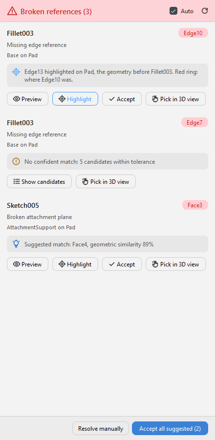

# Resolve_Mode

A FreeCAD addon that finds **broken PartDesign references** (fillet or chamfer edges that no longer exist, pocket up-to faces, sketch attachment faces, and so on) and helps you repair them from one panel.



- **Detects** every reference FreeCAD has marked missing (`?Edge14`), plus references to elements that no longer exist.
- **Suggests** a replacement by geometric similarity (type, size, position, direction, radius), for example *"Suggested match: Edge13, geometric similarity 89%"*.
- **Preview** shows the feature as it would regenerate with the suggestion, without changing anything. **Highlight** shows the suggested edge or face on the geometry before that feature, as when you first picked it.
- **Accept** relinks it as one undo step. **Accept all suggested** fixes every confident match at once.
- **Show candidates** lists the near-ties when no match is clear. **Pick in 3D view** lets you click the replacement yourself.
- **Auto mode** opens the panel after any recompute that breaks something. Turn it off with the checkbox in the panel header or in the preferences.

How it works, with answers to questions from FreeCAD's topological naming developers: **https://avongil.github.io/FreeCAD-Resolve_Mode/**

## Requirements

FreeCAD 1.1 or newer. Developed and tested on FreeCAD 27.1 dev (weekly 2026.11.04). PartDesign only.

## Install

Copy the repository folder into your FreeCAD user `Mod` folder, so that you get:

```
%APPDATA%\FreeCAD\<version>\Mod\Resolve_Mode\package.xml
%APPDATA%\FreeCAD\<version>\Mod\Resolve_Mode\freecad\Resolve_Mode\...
```

(`~/.local/share/FreeCAD/<version>/Mod/` on Linux, `~/Library/Application Support/FreeCAD/<version>/Mod/` on macOS.) Then restart FreeCAD.

## Use

- **PartDesign toolbar → Resolve broken references**, or **Tools → Resolve broken references**, opens or closes the panel.
- Click a feature name on a card to select it in the tree.
- A card marked *Waiting on …* depends on a feature that failed to recompute. Fix that feature first, and the card updates.
- **Resolve manually** opens the first broken feature in its normal FreeCAD editor (Attachment Editor for sketches).

### How suggestions work

While your model is healthy, Resolve_Mode stores a small fingerprint (about 100 bytes) of every referenced edge or face. The fingerprints go in a hidden property of the feature that holds the reference, and are saved with the file. When a reference breaks, the fingerprint is compared with the elements that exist now. A match is suggested only when it is at least 80% similar and clearly ahead of the runner-up. Otherwise the candidates are listed for you to choose from.

References that were already broken before the addon first saw the file have no fingerprint. For those you pick the replacement yourself, except sketches, which are matched by the plane they sit on.

## Preferences

**Edit → Preferences → Resolve_Mode**:

- Auto-open the panel
- Remember geometry, needed for suggestions
- Suggestion threshold (default 80%)
- Lead over the runner-up (default 8%)
- Candidate threshold (default 55%)

## Development

```
python -m pytest -q tests                 # scoring logic, no FreeCAD needed
freecadcmd tests/fc_scenario.py           # end-to-end inside FreeCAD
python -m ruff check .
```

## License

LGPL-2.1-or-later. See [LICENSE](LICENSE).
